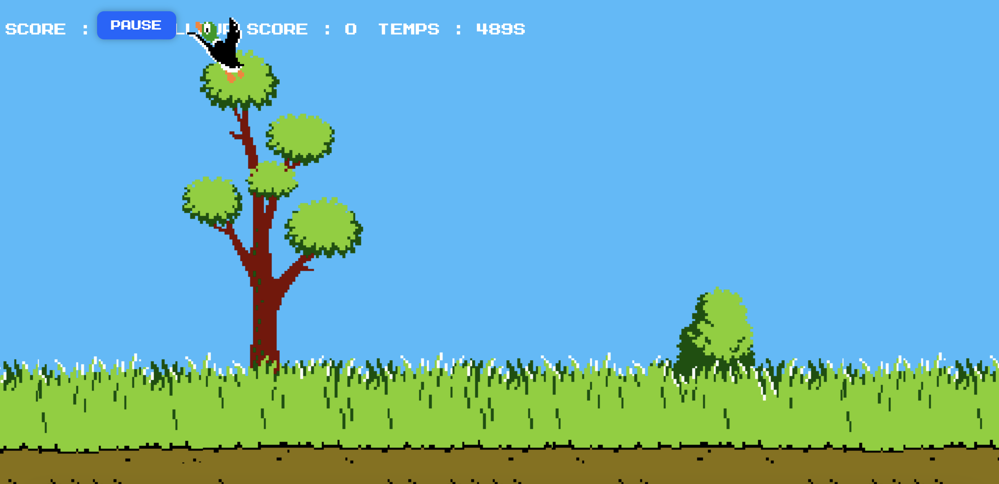

# 🦆 Duck Hunt Deluxe

A fast-paced browser shooting game built with vanilla HTML, CSS and JavaScript. Shoot the flying ducks before the timer runs out, climb to level 2 and try to beat your high score.



🎮 **[Play the game](LIEN_DU_JEU)**

---

## ✨ Features

- 🎯 Click on the ducks to shoot them
- 🐕 A dog collects the ducks after each wave
- 🌙 **Two levels**: level 2 starts at 10 points, with faster ducks and a night scenery
- 🏆 Win the game by reaching 30 points on level 2
- ⏱️ 200-second countdown
- ⏸️ Pause and resume at any time
- 💾 High score saved in the browser (`localStorage`)
- 🔊 Sound effects
- 📐 Layout that adapts when the window is resized

## 🕹️ How to play

1. Click **Jouer** to start.
2. Click on the ducks to score points. Each wave has one or two ducks.
3. Reach **10 points** to unlock level 2.
4. Reach **30 points** before the timer hits zero to win.
5. Use **Pause** to take a break.

The game is best played on a computer with a mouse. Touch support on phones is still basic.

## 🛠️ Technologies

- **HTML5**
- **CSS3** (layout, transitions, CSS filters for the level 2 scenery, media queries)
- **JavaScript** (DOM manipulation, `setInterval`, `localStorage`, game state management)

## 🚀 Run it locally

```bash
git clone https://github.com/Yelle-stack/duckHuntGame.git
cd duckHuntGame
```

Then open `index.html` in your browser. No installation or build step is needed.

## 📁 Project structure

```
duckHuntGame/
├── index.html      # Page structure and HUD
├── duckhunt.css    # Styles, scenery and responsive rules
├── duckhunt.js     # Game logic (ducks, levels, timer, score)
├── favicon.svg
├── favicon.png
└── ...             # Images and sounds
```

## ⚙️ Easy to customize

The main settings are at the top of `duckhunt.js`:

```js
const LEVEL_2_SCORE = 10;   // score needed to reach level 2
const LEVEL_2_SPEED = 1.5;  // duck speed multiplier on level 2
const LEVEL_2_TARGET = 30;  // score needed to win
```

## 🔮 Possible improvements

- Better touch controls and smaller ducks on mobile
- A third level with a new scenery
- Online leaderboard
- More enemy types and power-ups

## 🎨 Credits

Add the credits for your images, sounds and font here (author, licence, link).

## 👩‍💻 Author

**Jelena Zeko** – Full-Stack Developer
GitHub: [@Yelle-stack](https://github.com/Yelle-stack)
